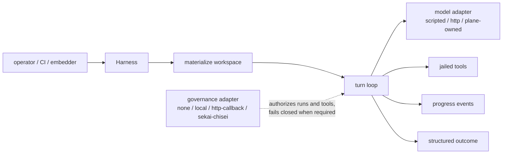

# shikigami (式神)

**A local-first headless agent harness: autonomous agent work as countable, governable runs.**

[](https://github.com/Sannrox/shikigami/actions/workflows/ci.yml)
[](https://github.com/Sannrox/shikigami/releases)
[](LICENSE)

[Try it](#try-it) · [Docs](docs/README.md) · [Design](DESIGN.md) · [Settings](docs/settings.md) · [Decisions](docs/decisions/README.md)

> **Status:** `v3.0.0`. Freeze-core library, settings, run, doctor JSON, and
> offline OSS paths follow semver under
> [ADR 0004](docs/decisions/0004-v1-contract.md). Additive evolution remains
> allowed on documented evolving/host-only surfaces (e.g. MCP). Offline
> `cargo test` is the supported baseline; live plane tests are ignored by default.

Shikigami (式神, the conjured familiar that carries out tasks for its
summoner) runs autonomous agent work as countable **runs**: materialize a
workspace, call a model, execute jailed tools, emit progress, and finish with
a structured result — without a desktop UI. Use it offline for demos and CI,
or wire it to a governance control plane for production.

- **Headless by default.** The same runs execute unattended in CI, on fleet
  hosts, or under an operator; a desktop shell is a client, never the runtime.
- **One shared core.** CLI, `serve` daemon, MCP, ACP, TUI, and in-process
  embedders all drive the same `Harness` library instead of reimplementing
  the loop.
- **Settings select adapters.** The loop is fixed; governance, model,
  workspace, and event adapters are picked by versioned TOML, so different
  use cases do not require forking the core
  ([ADR 0001](docs/decisions/0001-ports-and-settings.md)).
- **Fail closed when governed.** With a governed profile, a missing or
  unhealthy control plane fails `doctor` and `run` instead of silently
  degrading.
- **Jailed tools.** Tools operate inside the run workspace; Bash and other
  high-risk tools are opt-in, with settings-selected OS sandbox backends
  ([ADR 0013](docs/decisions/0013-os-sandbox-adapter.md)).
- **Offline deterministic baseline.** `cargo test` and the quickstart below
  pass with no control plane and no API keys.

Library upgrades from 2.x: see the [3.0 upgrade notes](CHANGELOG.md#300--2026-10-30)
for worker credentials, claim runtime tokens, fail-closed remote governance,
and the explicit namespace. 1.x to 2.0: see the
[2.0 upgrade notes](CHANGELOG.md#200--2026-10-08) for the shared binary
resolver payload and public enum changes.

| Path | What you get |
| --- | --- |
| **Local / OSS** | No external plane. Scripted or HTTP models. Deterministic tests. |
| **Governed** | First-party adapter for [sekai-chisei](https://github.com/Sannrox/sekai-chisei): policy, budget, PlanExecution, audit-oriented events. |
| **Delivery** | Optional packaging via [tenkai](https://github.com/Sannrox/tenkai). Delivery is not a runtime dependency. |

## Try it

No control plane, no API keys — uses the built-in **scripted** model:

```bash
git clone https://github.com/Sannrox/shikigami.git
cd shikigami
cargo build --release

./target/release/shikigami doctor
./target/release/shikigami --config examples/local-run.toml run "demo" --keep-workspace
```

`doctor` prints the effective profile, adapters, and tool set and ends with
`status: ok`. The run writes `SHIKIGAMI_OK.txt` under the run workspace and
reports success (paths shortened):

```text
run b7d182a5-273a-4082-87d3-5eebd355eb85 turns=2 success=true termination=completed summary=scripted run complete
workspace .../runs/b7d182a5-273a-4082-87d3-5eebd355eb85/workspace
artifacts .../runs/b7d182a5-273a-4082-87d3-5eebd355eb85/artifacts
```

### Requirements

- [Rust](https://rustup.rs/) toolchain pinned in [rust-toolchain.toml](rust-toolchain.toml) (Rust 2024)
- macOS or Linux (primary targets today)
- Optional: a running [sekai-chisei](https://github.com/Sannrox/sekai-chisei) for the governed path
- Optional: OpenAI-compatible HTTP endpoint for ungoverned `http` model turns

The governed adapter uses the pinned upstream `sekai-client` Rust facade and
canonical `sekai-proto` dependency; no local `protoc` installation is needed.

### Prebuilt binaries

Tagged releases publish multi-arch archives from GitHub Actions
([Releases](https://github.com/Sannrox/shikigami/releases)):

| Archive suffix | Target |
| --- | --- |
| `aarch64-apple-darwin` | Apple Silicon macOS |
| `x86_64-apple-darwin` | Intel macOS |
| `x86_64-unknown-linux-gnu` | Linux x86_64 |
| `aarch64-unknown-linux-gnu` | Linux aarch64 |

Each archive includes a `sha256` checksum. Prefer building from source when
you need a custom feature set.

## How it works



A **run** is one countable unit of work: a materialized **workspace**, a
model turn loop, jailed tool calls, and a structured outcome. Every external
dependency sits behind a **port**; settings select the **adapter** for each
port, so the same binary covers offline tests and governed production
([ADR 0001](docs/decisions/0001-ports-and-settings.md)).

- **Core owns** run lifecycle, workspace materialization, tool jail, event
  emission.
- **Adapters own** governance, model source (when not plane-owned), workspace
  kind, and event sinks.
- **sekai-chisei** (when selected) owns policy, budget, governed model
  execution, and durable operational truth.
- **tenkai** (when used) owns shipping the binary — never process config.

**Why not a chat window or a one-off CLI?** Most coding agents stop there:
governance is missing or bolted on after the fact, the same execution core
cannot run unattended in CI or on a fleet host, and desktop shells
reimplement the loop instead of sharing a testable library. Shikigami is the
**execution plane**: built on one shared library core, headless by default,
fail-closed when governance is required, and pluggable when it is not.
Details: [VISION.md](VISION.md), [DESIGN.md](DESIGN.md),
[docs/adapters.md](docs/adapters.md).

## Next steps

Choose a process host for the common integration paths:

- CLI: one-shot operator and CI use (`doctor` / `run`) — [CLI reference](docs/cli.md)
- `serve`: long-running filesystem or plane-claim intake — [serve guide](docs/serve.md)
- MCP stdio: IDE and tool clients — [MCP guide](docs/mcp.md)
- ACP / TUI: session guest and interactive terminal host — [ACP](docs/acp.md), [TUI](docs/tui.md)
- Library: advanced in-process integrations that need direct results,
  cancellation, events, or metrics — [embedding guide](docs/embedding.md)

Settings are versioned TOML. Select adapters and explicit policy settings for
your use case; see the [configuration reference](docs/settings.md) for the
schema, environment variables, resolution order, and compatible version-1
profiles. New configurations should specify adapters and
`governance.fail_closed` explicitly.

Examples:

- [`examples/local-run.toml`](examples/local-run.toml) — offline
- [`examples/cliproxy-http.toml`](examples/cliproxy-http.toml) — ungoverned `http` model through a local OpenAI-compatible gateway (CLIProxyAPI)
- [`examples/governed-sekai-chisei.toml`](examples/governed-sekai-chisei.toml) — plane-backed; follow the [governed guide](docs/governed-path.md)
- [`examples/tenkai-product.toml`](examples/tenkai-product.toml) — binary delivery only

## Contributing

See [CONTRIBUTING.md](CONTRIBUTING.md) for development setup and
[project verification](docs/project-verification.md) for the deterministic gates.
Agent/repo operating rules: [AGENTS.md](AGENTS.md).

## Documentation map

| Document | Audience |
| --- | --- |
| [VISION.md](VISION.md) | Why this product exists |
| [DESIGN.md](DESIGN.md) | Architecture and boundaries |
| [docs/README.md](docs/README.md) | Full documentation index |
| [docs/cli.md](docs/cli.md) | CLI command and option reference |
| [docs/governed-path.md](docs/governed-path.md) | Governed setup and doctor checks |
| [CONTEXT.md](CONTEXT.md) | Domain glossary and naming |
| [docs/settings.md](docs/settings.md) | Configuration reference |
| [docs/adapters.md](docs/adapters.md) | Ports and built-in adapters |
| [docs/embedding.md](docs/embedding.md) | Library integration |
| [docs/decisions/](docs/decisions/) | Accepted ADRs |
| [CHANGELOG.md](CHANGELOG.md) | Notable changes |
| [SECURITY.md](SECURITY.md) | Vulnerability reporting |
| [CODE_OF_CONDUCT.md](CODE_OF_CONDUCT.md) | Community norms |

## License

Licensed under the [Apache License, Version 2.0](LICENSE).
